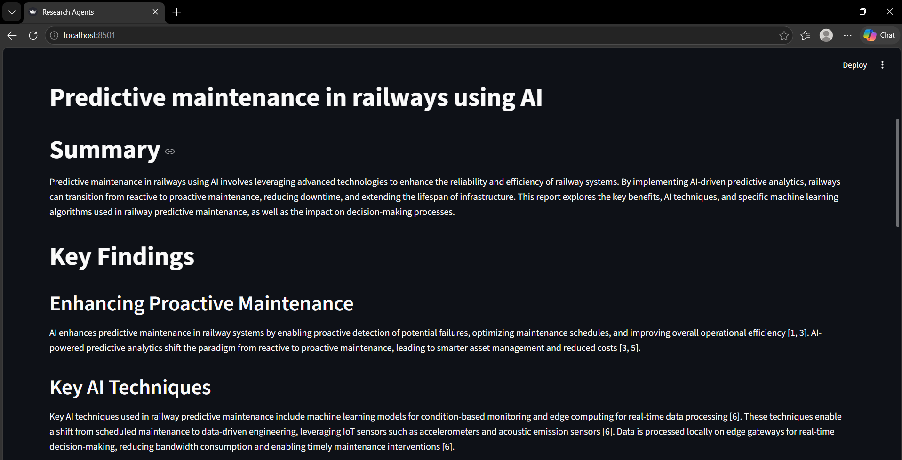
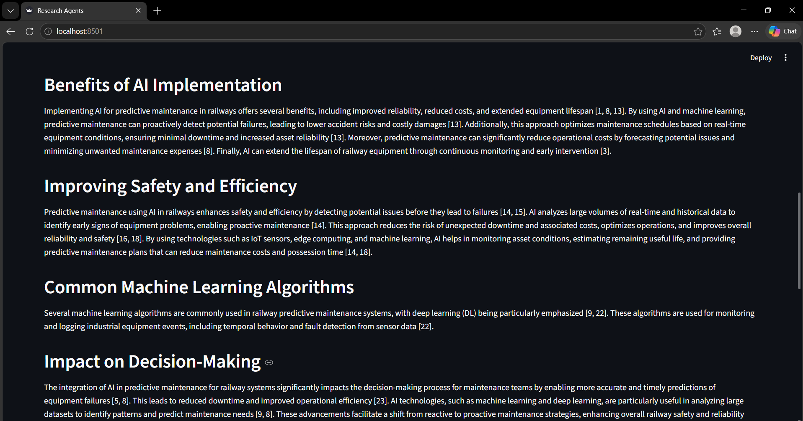
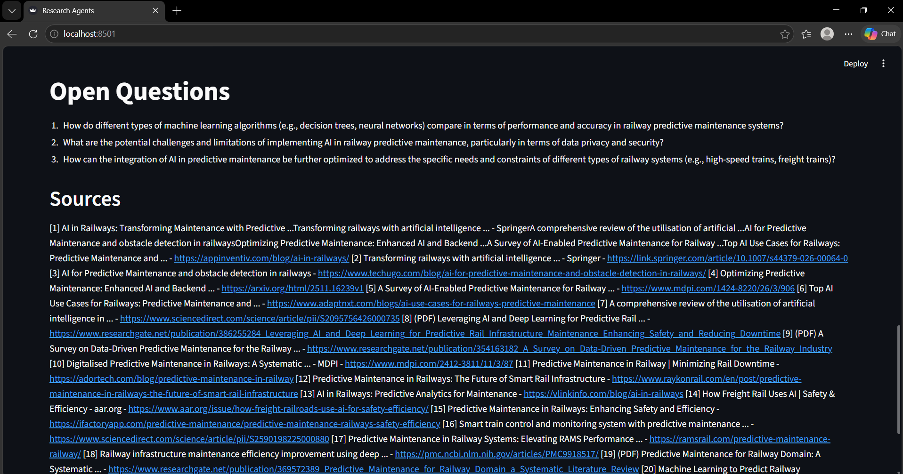

# Multi-Agent Collaborative System for Automated Research

Give it a topic and four AI agents work together to produce a cited research report. It runs fully on your own laptop, free, using a local model through Ollama. No API keys and no usage limits.

## Features

- Four specialised agents: Planner, Researcher, Critic and Writer
- Live web search with sponsored ads filtered out
- Reads the full text of web pages, with an automatic fallback to search snippets when a site blocks it
- A Critic loop that finds gaps in the research and sends the Researcher back for more (max 2 rounds)
- Numbered citations like [1] in the text, with a Sources list of real URLs
- Runs 100% locally on a laptop GPU (tested on an RTX 3050 with 6 GB VRAM and 16 GB RAM)

## How it works

    Topic -> Planner -> Researcher (web search + page reading) -> Critic -> Writer -> report.md
                              ^_______ follow-up questions _______|  (max 2 rounds)

| Agent | Job |
|---|---|
| Planner | Breaks the topic into 3-4 specific, searchable sub-questions |
| Researcher | Searches the web, reads up to 3 full pages per question, and writes notes with numbered citations |
| Critic | Reads all notes, finds gaps, and asks up to 2 follow-up questions, or approves |
| Writer | Writes the final Markdown report: Summary, Key Findings, Open Questions, Sources |

## Project structure

    research-agents/
      main.py            Orchestrator: runs the agents in order and saves the report
      app.py             Streamlit web interface
      agents.py          The four agents and their prompts
      tools.py           Web search (ddgs) and page reader (httpx + trafilatura)
      llm.py             Thin wrapper around the local Ollama model
      requirements.txt   Python dependencies
      reports/           Generated reports (Markdown)

## Requirements

- Windows, macOS or Linux
- Python 3.10 or newer
- Ollama (https://ollama.com)
- A GPU with about 6 GB VRAM for the 7B model (a smaller model works on less)
- Internet connection for web search

## Setup

1. Install Ollama, then download the model (about 4.7 GB, one time):

        ollama pull qwen2.5:7b

2. Clone the repo and install dependencies:

        git clone https://github.com/prashant-7-8-7/research-agents.git
        cd research-agents
        python -m venv venv
        .\venv\Scripts\Activate.ps1
        pip install -r requirements.txt

   On macOS or Linux, activate with: source venv/bin/activate

## Usage

    python main.py "Edge AI for smart cities"

You will see each agent report its progress:

    [Planner] planning...
    [Researcher] round 1 : ...
        read 3 full pages, 3 snippets
    [Critic] checking notes...
    [Writer] writing report...
    Saved to reports\edge-ai-for-smart-cities.md

A run takes about 5-12 minutes on a laptop GPU, because each model call takes 10-60 seconds. The report is saved in the reports folder under the topic name. Running the same topic again overwrites it, so copy the file first if you want to keep it.

## Run the web app

    streamlit run app.py

Open http://localhost:8501, type a topic and click Run research. The status box shows each agent's progress live, and the finished report appears on the page with a download button.

## Screenshots

## Sample output

See [reports/edge-ai-for-smart-cities.md](reports/edge-ai-for-smart-cities.md).

## Configuration

| What | Where | Default |
|---|---|---|
| Model | MODEL in llm.py | qwen2.5:7b |
| Context size | num_ctx in llm.py | 8192 |
| Critic rounds | rounds in run() in main.py | 2 |
| Search results per question | web_search(q, 6) in main.py | 6 |
| Full pages read per question | pages < 3 in main.py | 3 |
| Characters read per page | max_chars in fetch_page() in tools.py | 2500 |

For a GPU with only 4 GB of VRAM, use a smaller model such as qwen2.5:3b and change MODEL in llm.py.

## Troubleshooting

- **ollama is not recognized:** close PowerShell and open a new one, or sign out and back in so the PATH refreshes.
- **Search returns nothing or prints "search failed":** the free search service sometimes rate-limits. Wait a few seconds and run again.
- **"read 0 full pages" for every question:** your network may be blocking page downloads. The agents still work from search snippets.
- **PowerShell blocks Activate.ps1:** run Set-ExecutionPolicy -Scope CurrentUser RemoteSigned once.
- **Notepad cannot find the report:** open it with the full path, or print it with Get-Content reports\your-report.md

## Limitations

- A small local 7B model can write generic sentences or attach a citation to a claim the source does not make. Spot-check important claims against the sources.
- Some sites, mostly academic publishers, block automated page reads. For those, the Researcher uses the search snippet instead.
- Web search uses DuckDuckGo and can occasionally rate-limit.
- Vendor blogs can appear among the sources. Check how reliable a source is before quoting a number from it.

## Roadmap

- Streamlit web interface with live agent progress (done)
- PDF export of the report
- Source reliability scoring
- Support for reading PDF papers

## Tech stack

Python, Ollama (qwen2.5:7b), ddgs, httpx, trafilatura

## Author

prashant-7-8-7

